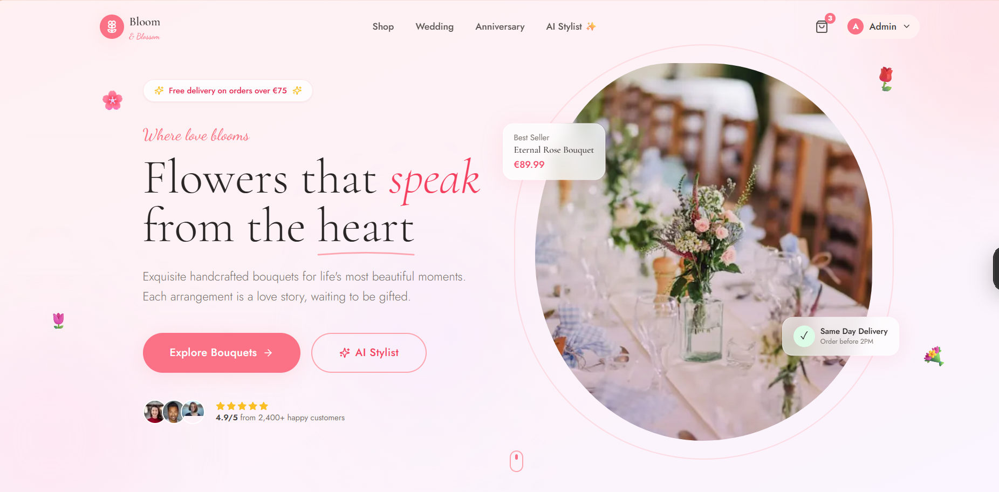
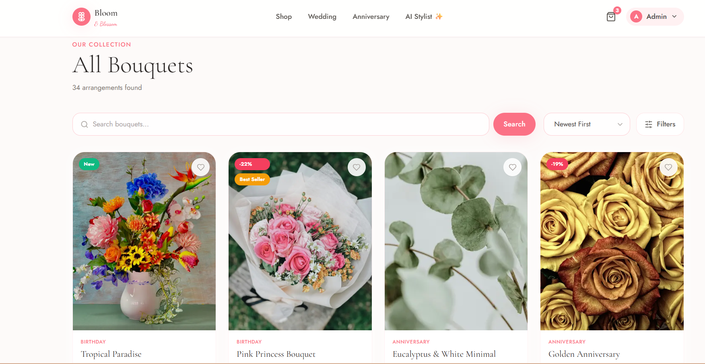
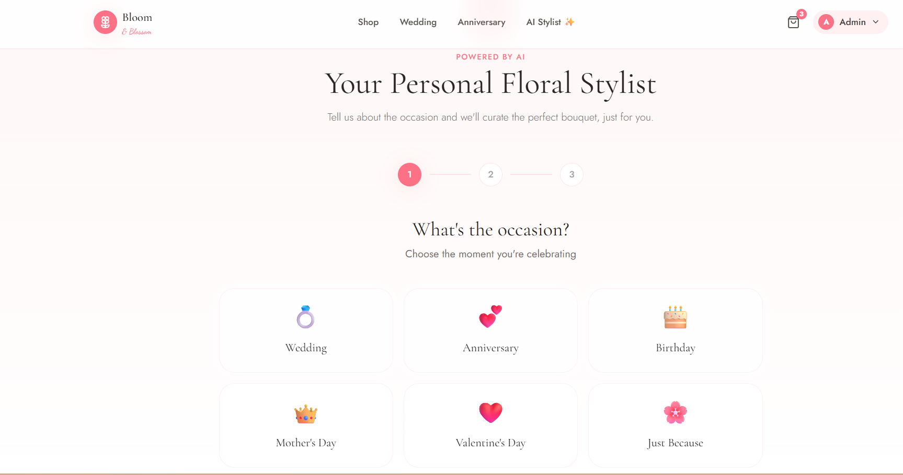
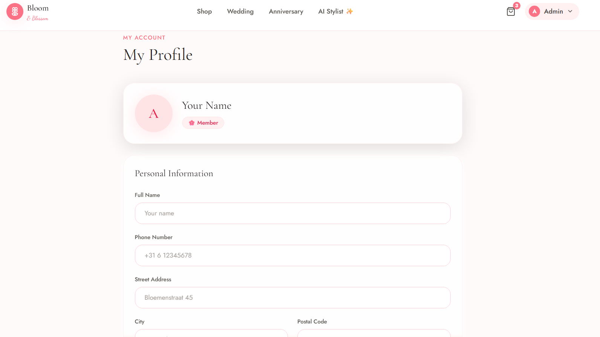
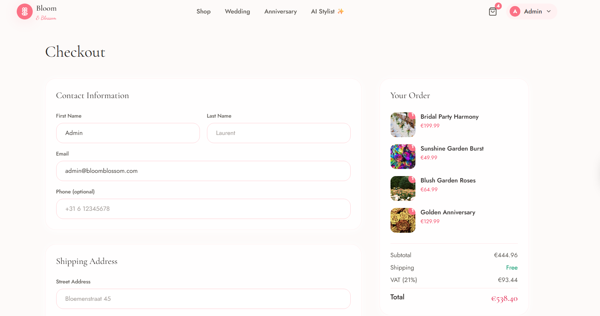

# 🌸 Bloom & Blossom

**A premium, full-stack floral e-commerce platform** — built to demonstrate production-grade engineering across the modern web stack: Next.js 14, TypeScript, PostgreSQL, Prisma, NextAuth, and real AI integration via OpenAI.

🔗 **Live demo:** https://bloom-ivory-kappa.vercel.app
📦 **Repository:** https://github.com/may379/Bloom

---

## 📸 Screenshots

<table>
  <tr>
    <td width="50%"></td>
    <td width="50%"></td>
  </tr>
  <tr>
    <td align="center"><b>Homepage</b></td>
    <td align="center"><b>Shop — Catalogue & Filters</b></td>
  </tr>
  <tr>
    <td width="50%"></td>
    <td width="50%"></td>
  </tr>
  <tr>
    <td align="center"><b>Product Detail</b></td>
    <td align="center"><b>AI Floral Stylist</b></td>
  </tr>
  <tr>
    <td width="50%"></td>
    <td width="50%"></td>
  </tr>
  <tr>
    <td align="center"><b>Admin Dashboard</b></td>
    <td align="center"><b>Checkout Flow</b></td>
  </tr>
</table>

---

## 📋 Demo Accounts

| Role | Email | Password |
|------|-------|----------|
| Admin | `admin@bloomblossom.com` | `Admin123!` |
| Customer | `demo@bloomblossom.com` | `User123!` |

---

## ✨ Why This Project

Most portfolio projects stop at CRUD. Bloom & Blossom goes further — it's built to mirror what a small e-commerce team would actually ship:

- A **real AI feature** (OpenAI GPT-4o-mini), not a mocked one
- **Role-based access control** separating customer and admin experiences
- A complete **commerce flow**: catalogue → cart → checkout → order tracking → admin fulfillment
- Production concerns handled from day one: SEO metadata, image optimization, server-side rendering, and a normalized relational schema

---

## 🛠️ Tech Stack

| Layer | Technology |
|---|---|
| **Framework** | Next.js 14 (App Router, Server Components, Server Actions) |
| **Language** | TypeScript (strict mode) |
| **Styling** | Tailwind CSS, Framer Motion |
| **Database** | PostgreSQL (hosted on Neon) |
| **ORM** | Prisma |
| **Auth** | NextAuth.js (credentials provider, JWT sessions, RBAC) |
| **State** | Zustand (client-side cart) |
| **Forms & Validation** | React Hook Form + Zod |
| **AI** | OpenAI API (GPT-4o-mini) |
| **Deployment** | Vercel |
| **Testing** | Vitest, Testing Library |

---

## 🧩 Core Features

### Customer-facing
- Browse, search, and filter a catalogue of 30 floral arrangements across 8 categories
- Server-rendered product detail pages with image galleries and customer reviews
- Persistent cart (Zustand) with quantity management
- Full checkout flow with order summary and confirmation
- Order history with live status tracking (Pending → Confirmed → Shipped → Delivered)
- **AI Floral Stylist** — describes an occasion, budget, and colour preference; GPT-4o-mini returns 3 personalized bouquet recommendations with natural-language explanations, pulled live from the actual product catalogue (not hardcoded)

### Admin dashboard
- Protected by role-based middleware — customers cannot access admin routes, even via direct URL
- Full CRUD on products, categories, and orders
- Order status management with real-time updates
- User management overview
- Dashboard metrics (revenue, order volume, customer count)

### Engineering details that matter
- Relational schema with 12 normalized models (`User`, `Order`, `OrderItem`, `Flower`, `Review`, `Cart`, etc.) and referential integrity enforced at the database level
- Server Actions for mutations — no manually wired REST endpoints for internal app logic
- Zod schemas shared between client validation and server-side enforcement
- Optimized images via `next/image` with remote pattern allowlisting
- SEO: dynamic metadata, sitemap.xml, robots.txt, Open Graph tags
- 40+ unit tests (Vitest) covering validation schemas and cart state management

---

## 🤖 The AI Stylist — How It Actually Works

This isn't a rule-based system dressed up as AI. The recommendation flow is:

1. Customer selects occasion, budget range, and colour preferences
2. The server queries Postgres for in-stock products matching the budget
3. That live catalogue subset is sent to **OpenAI's GPT-4o-mini** with a structured prompt
4. The model selects the top 3 matches and writes a natural-language rationale for each
5. If the OpenAI call fails, the user sees an explicit error state — there is no silent fallback to fake data

```
Customer preferences → Postgres query (live stock) → GPT-4o-mini → Ranked recommendations
```

---

## 🏗️ Architecture

```
src/
├── app/                    # Next.js App Router
│   ├── (auth)/              # Login, register
│   ├── (shop)/               # Public storefront: shop, product, cart, checkout
│   ├── (dashboard)/          # Customer account: profile, orders
│   ├── (admin)/               # Protected admin panel
│   └── ai-recommendation/    # AI Stylist
├── actions/                 # Server Actions (mutations & queries)
├── components/                # UI, organized by domain
├── lib/                       # Prisma client, auth config, validation schemas, utils
├── hooks/                     # Zustand cart store, toast hook
└── tests/                     # Vitest unit tests
prisma/
├── schema.prisma              # 12-model relational schema
└── seed.ts                    # Seed script: categories, products, demo users, sample orders
```

---

## 🚀 Running Locally

```bash
git clone https://github.com/may379/bloom-blossom.git
cd bloom-blossom
npm install
```

Create `.env` from `.env.example` and fill in:

```env
DATABASE_URL=
NEXTAUTH_URL=http://localhost:3000
NEXTAUTH_SECRET=
OPENAI_API_KEY=
```

```bash
npx prisma migrate dev
npm run db:seed
npm run dev
```

App runs at `http://localhost:3000`.

### Tests

```bash
npm run test
```

---

## 📦 Deployment

Deployed on **Vercel**, with PostgreSQL hosted on **Neon**. CI runs Prisma generation and a production build on every push to `main`.

---

## 👩‍💻  Author

Built by **May Amor**, a full-stack developer (MERN, Next.js, TypeScript, Python/FastAPI)


- 🔗 [Portfolio](https://portfolio-mu-two-43.vercel.app) · [GitHub](https://github.com/may379) · [LinkedIn](https://www.linkedin.com/in/may-amor-abb049305)


---

## 📄 License

This project is available for portfolio and educational reference. Contact for commercial use inquiries.
